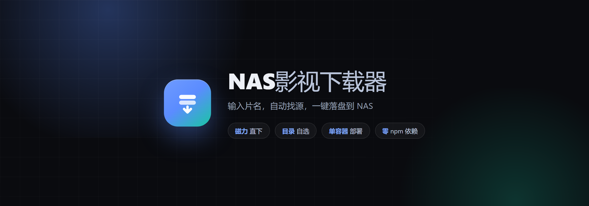
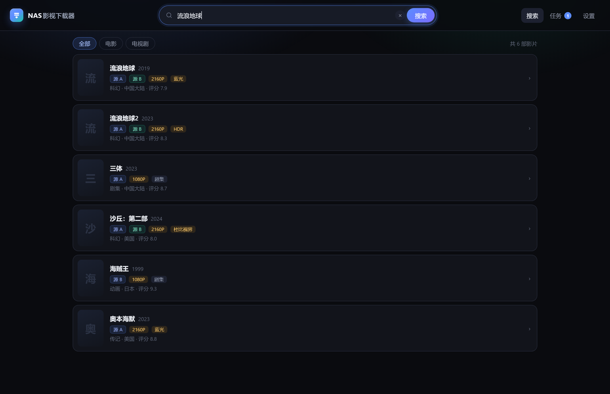
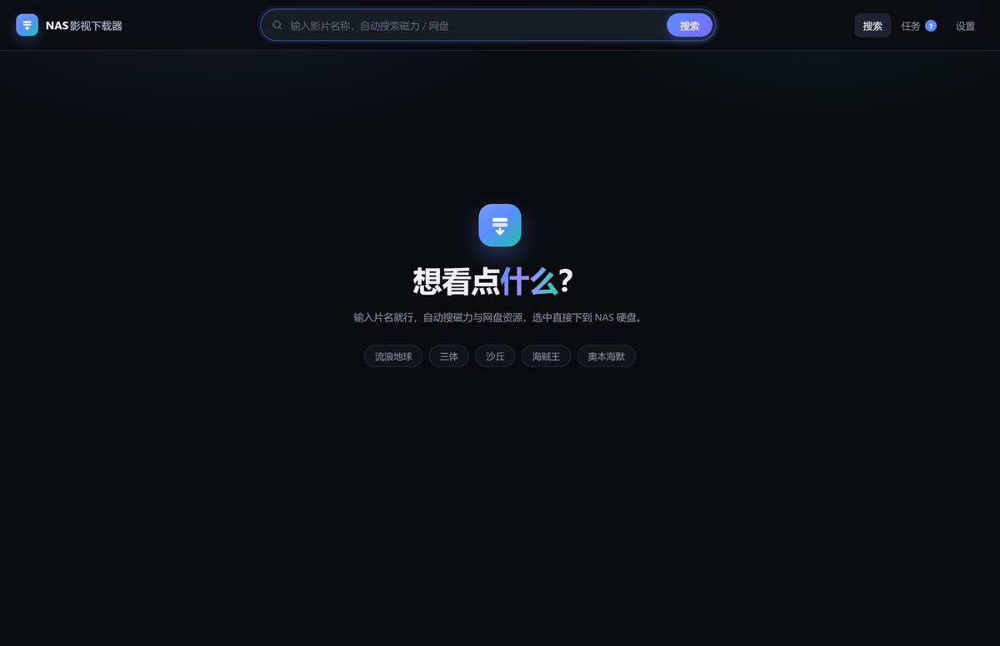
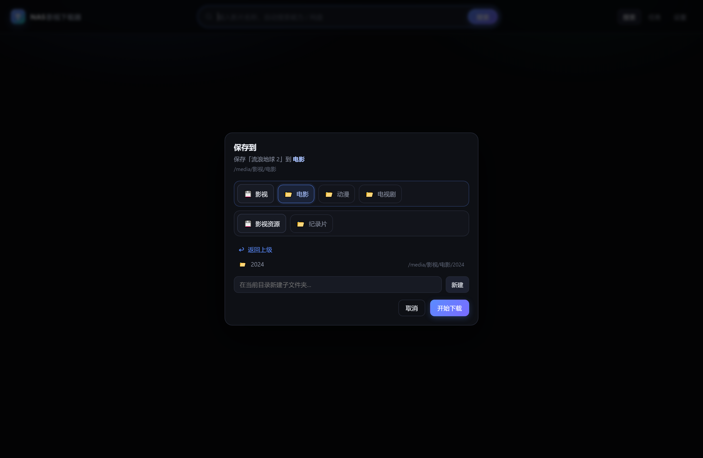
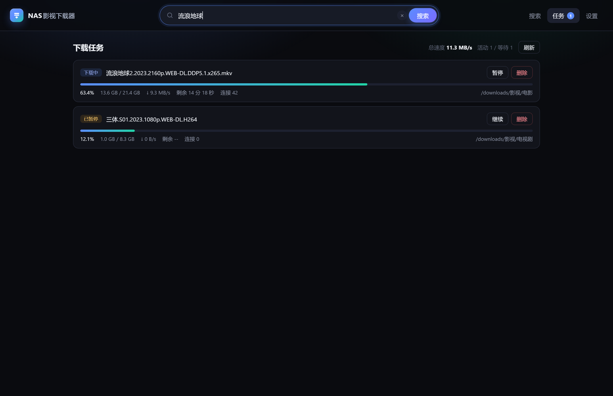
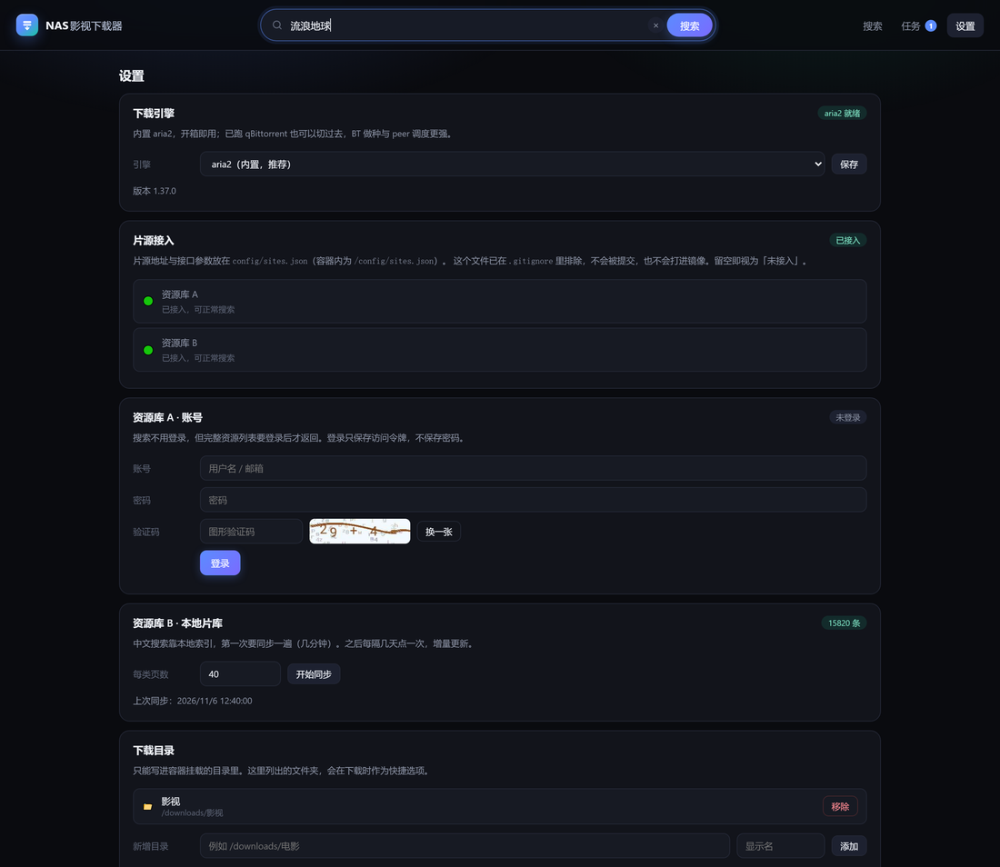

# NAS影视下载器

<p align="center">
  
</p>

<p align="center">
  在浏览器里输入片名，自动搜出资源，点一下直接下到 NAS 指定文件夹。
</p>

<p align="center">
  
</p>

## 功能

- **一个框搞定**：输入片名自动搜索，不用按回车，也不用记网址
- **多来源聚合**：同名影片自动合并成一条，资源按 `4K / 蓝光 / 1080P / 720P` 分档，重复磁力自动去重
- **磁力直下**：内置 aria2，DHT / PEX / LPD 全开，自动加载 tracker，支持断点续传
- **网盘链接**：一并列出，一键复制，配合你常用的网盘工具使用
- **多存储库**：支持挂载多块盘，按「库 → 分类文件夹」两级选择；电影默认落「电影」、剧集落「电视剧」、动漫落「动漫」，也能进任意子目录或就地新建
- **目录白名单**：只能写进容器挂载的目录，没法越权写到系统盘
- **任务管理**：进度、速度、剩余时间、连接数，支持暂停 / 继续 / 删除（可连同文件一起删）
- **可选引擎**：默认 aria2，也能接自己的 qBittorrent
- **轻量**：零 npm 依赖，单容器，x86 与 ARM 都能跑

<p align="center">
  
  
</p>

## 部署

### 1. 放到 NAS 上

```bash
git clone <你的仓库地址> /vol1/1000/docker/nas-media-downloader
cd /vol1/1000/docker/nas-media-downloader
```

没有 git 就把整个目录拷进去。

### 2. 改配置

**`docker-compose.yml`** 只需要改端口和你的媒体目录：

```yaml
ports:
  - "9696:8080"          # 左侧是网页端口，可自行修改
volumes:
  # 左边是 NAS 上真实的媒体目录，右边决定界面上显示的库名
  - /vol1/1000/影视:/media/影视
  - /vol4/1000/影视资源:/media/影视资源
  - ./config:/config
environment:
  - PUID=1000            # 你的用户 UID，SSH 里执行 id 查看
  - PGID=1000
  - ARIA2_SECRET=换成随机字符串
```

`/media` 下的每个一级目录就是一个存储库，界面上按「库 → 分类文件夹」两级选择，加新的盘只要再加一行 volumes。

### 3. 片源配置

```bash
cp config/sites.example.json config/sites.json
```

按文件里的注释填写你自己的片源信息。留空也能启动，界面会提示「资源库未接入」，不影响其它功能。这个文件已被 `.gitignore` 排除，**不会被提交到仓库，也不会打进镜像**。

### 4. 启动

```bash
docker compose up -d --build
```

打开 `http://NAS的IP:9696`。

群晖 / 飞牛也可以走图形界面：Docker → Compose → 新建项目 → 选择这个目录的 `docker-compose.yml`。

## 端口

| 端口 | 协议 | 用途 | 必需 |
|---|---|---|---|
| 9696 → 8080 | TCP | Web 界面 | 是 |
| 51413 | TCP | BT 监听 | 强烈建议 |
| 51413 | UDP | DHT 监听 | 强烈建议 |

**下载速度主要取决于 51413 有没有放通。** 除了 compose 里的映射，还要在路由器上做端口转发（51413 TCP + UDP，指向 NAS 内网 IP），并在 NAS 防火墙放行同端口。没放通也能下，但只能连到主动连进来的 peer，速度会明显差一截。

<p align="center">
  
</p>

## 使用

1. 首页输入片名（中文即可），停顿一下自动搜索
2. 点搜索结果，右侧弹出该片所有来源的资源，按清晰度分组
3. 点「下载」，选保存文件夹 —— 会按影片类型自动帮你选好
4. 在「任务」里看进度，下完直接出现在你的媒体库里

首次使用建议先去「设置」：

- 需要登录的片源，登录一次（只保存访问令牌，不保存密码）
- 需要本地片库的片源，点一次「开始同步」建索引，之后隔几天增量同步

<p align="center">
  
</p>

## 配置项

| 环境变量 | 默认 | 说明 |
|---|---|---|
| `PORT` | `8080` | 容器内 Web 端口 |
| `PUID` / `PGID` | `1000` | 下载文件的属主，需和媒体目录一致 |
| `MEDIA_ROOT` | `/media` | 自动发现存储库的根目录，其下每个一级目录算一个库 |
| `DOWNLOADS_DIRS` | 空 | 手动指定库列表，如 `影视=/media/影视,影视资源=/media/影视资源`；设置后优先于自动发现 |
| `ARIA2_SECRET` | 空 | aria2 RPC 密钥，建议设置 |
| `ACCESS_PASSWORD` | 空 | 设置后访问需要密码，暴露到公网时务必设置 |
| `TZ` | `Asia/Shanghai` | 时区 |

存储库白名单：容器只允许写入已挂载的媒体目录及其子目录。要新增可写目录，在 compose 的 `volumes` 里追加一行映射即可，无需改代码；界面上也能随时「新建子文件夹」。

## 目录结构

```
nas-media-downloader/
├─ Dockerfile / docker-compose.yml
├─ config/
│  ├─ sites.example.json      片源配置示例（提交）
│  └─ sites.json              你自己的配置（已 gitignore）
├─ docker/
│  ├─ entrypoint.sh           启动 aria2 与 Web 服务
│  └─ trackers-default.txt    内置 tracker 列表（离线兜底）
├─ server/
│  ├─ index.js                HTTP 路由与接口
│  ├─ settings.js             配置读写与目录白名单
│  ├─ indexer.js              本地片库索引
│  ├─ engine/                 下载引擎适配（aria2 / qBittorrent）
│  ├─ sources/                片源适配层
│  └─ lib/                    聚合与工具函数
└─ public/                    前端页面（原生 JS，无构建步骤）
```

## 常见问题

| 现象 | 处理 |
|---|---|
| 页面打不开 | `docker logs nas-media-downloader` 看是否端口占用 |
| 设置里引擎显示离线 | aria2c 没起来，看容器启动日志；或切到 qBittorrent |
| 提示「资源库未接入」 | `config/sites.json` 没填或没挂载，填好后重启容器 |
| 下载一直是 0 速度 | 51413 没放通，或该资源本身没有做种者 |
| 搜不到片 | 换个片名，或在设置里同步一次片库 |
| 点下载提示无权限 | 目录不在白名单内，先在 compose 里映射该目录 |
| 权限不对、文件改不了 | `PUID/PGID` 与该目录属主不一致，用 `ls -nd 目录` 查 |
| 媒体库里看不到片 | 下拉框选错库了，两个盘都挂上后重新选一次目录 |

## 说明

本项目只是一个下载客户端，不自带、不存储、不提供任何资源内容，只做本机下载与文件管理。片源接口由使用者自行配置，项目本身不内置任何站点地址。

## 免责声明

请仅用于获取你有权访问的内容，并遵守所在地区的法律法规。使用者需自行承担因使用本软件产生的一切后果，作者不对任何第三方内容的合法性、准确性负责。
